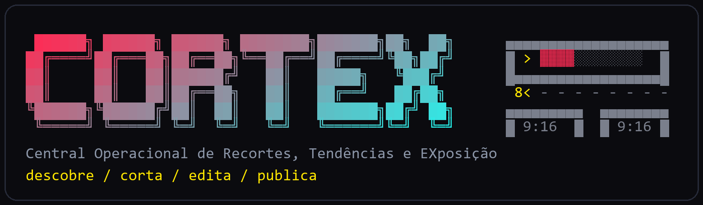

  

Sistema local (roda no seu PC, pelo CMD) que faz sozinho todo o ciclo de um canal de cortes:

| Etapa | O que faz |
|---|---|
| 1. Descobre | O que está em alta no Brasil: Google Trends, Google Notícias, X/Twitter, YouTube, Twitch e Kick. Ou busca o tema que você mandar, ou corta um link que você colar. |
| 2. Acha os vídeos | Lives de hoje de canais grandes, podcasts, debates, polêmicas, games, humor (YouTube, Twitch, Kick). |
| 3. Escolhe os momentos | Transcreve (legenda da plataforma ou Whisper local) e a IA escolhe os trechos com mais chance de viralizar, com nota de 0 a 100 e o porquê. Assunto longo vira Parte 1, 2, 3. |
| 4. Baixa só o necessário | Só os trechos que viram corte, nunca o vídeo inteiro. |
| 5. Edita em 9:16 | Vídeo + gameplay/ASMR, fundo desfocado ou tela cheia; legenda grande palavra por palavra; título com emoji; selo PARTE X; barra de progresso; áudio normalizado. |
| 6. Publica | YouTube Shorts, TikTok e Reels do Instagram (opcional), pelo navegador, sozinho ou depois da sua aprovação. |
| 7. Relata | Painel ao vivo no terminal, relatório HTML, notificação do Windows e cópia no OneDrive. |

## Primeiros passos

Dê dois cliques em **`cortex.bat`**. O menu tem só o essencial:

| Opção | O que faz |
|---|---|
| **LIGAR O AUTOMÁTICO** | Mostra o aviso de risco de banimento, você dá OK, ele confere os logins, diz quantos vídeos vai postar por dia em cada rede e começa. Passa a ligar junto com o Windows. |
| **Fazer cortes agora** | Cole um link, escreva um assunto ou deixe vazio para ele escolher o que está em alta. |
| **Ver cortes prontos** | Assistir, editar, publicar ou descartar. |
| **Resultados** | Views dos posts, saúde das contas e últimas rodadas. |
| **Contas** | Entrar no YouTube, TikTok, Instagram, API oficial do YouTube e Claude. |
| **Ajustes** | Vídeos por dia, nível da polêmica, assuntos, iniciar com o Windows, diagnóstico. |

## Automático 24/7

Roda em segundo plano: fechar o terminal não para nada, e um vigia do Windows religa se cair. Abrir o CORTEX mostra a situação (o que está rodando, próximo post, logins). Painel ao vivo com o que está acontecendo agora, a fila de cortes, os posts do dia, o próximo horário e o log rolando.

| Parte | Como funciona |
|---|---|
| Produção | Quando a fila de cortes prontos fica baixa, roda uma rodada completa e enche a fila. Espera enquanto você usa o PC. |
| Editor-chefe | Lê a fala de cada corte, dá nota, barra o que não pode ir ao ar e decide sozinho o que posta e o que descarta (com o motivo). |
| Publicação | Posta um corte por vez, espaçado, preferindo o horário nobre de cada dia da semana. |
| Conta nova | Começa devagar: a quantidade por dia cresce com a idade da conta até o seu limite (Ajustes). |
| CAPTCHA | O CORTEX não resolve CAPTCHA. Ele abre a janela na sua tela, avisa com som e notificação, você resolve e ele continua o mesmo post. Sem resposta em 30 minutos, ou se a rede pedir mais de 2 vezes no mesmo dia, aquela rede fica parada até você entrar em Contas. |
| Erros | Nada derruba o automático: ele registra, espera e tenta de novo. Um corte nunca é enviado duas vezes para a mesma rede. |

Variações: `cortex autopiloto --teste` (simula a publicação) e `cortex autopiloto --so-produzir`.

## O que deu certo e o que não deu (testes A/B de verdade)

Em **Resultados** (ou `cortex analise`):

| Parte | Como funciona |
|---|---|
| Números reais | Lê o YouTube Studio e o TikTok Studio do próprio canal: views, curtidas, % que continua vendo, tempo médio. |
| Nota das contas | 0 a 100 por rede: alcance 35, retenção 30, tendência 15, engajamento 10, conta 10. Com menos de 3 posts com 20 h, é provisória. |
| Testes A/B | Cada corte é sorteado antes de ser feito. Só julga em marcos fixos (12, 24, 40, 60, 90 posts de cada lado). Em simulação, 5% de falso vencedor. O vencedor vai para 80% dos cortes. |
| Tempo até viralizar | Faixa, nunca data, com o grau de confiança. Com menos de 5 posts com 24 h, avisa que é chute. |
| Analista | Uma vez por dia o Claude lê tudo e separa prova, indício e palpite. Sugere buscas e o que evitar. |
| Estrategista | Muda a quantidade por dia (um passo por vez, com 8 ou mais posts medidos, dentro do teto) e a mistura de assuntos. |

## YouTube pela API oficial (recomendado)

Com a API conectada, o YouTube recebe os vídeos pelo caminho autorizado do Google, sem abrir navegador. O navegador vira plano B. Em **Contas > YouTube pela API oficial** (ou `cortex login youtube-api`) ele mostra o passo a passo: criar um projeto em console.cloud.google.com, ativar a YouTube Data API v3, publicar a tela de consentimento, criar um ID de cliente OAuth do tipo App para computador e baixar o JSON. O token fica criptografado pelo Windows em `data/` e nunca vai para o repositório.

## Comandos (CMD, dentro da pasta do CORTEX)

| Comando | O que faz |
|---|---|
| `cortex` | abre o menu |
| `cortex autopiloto` | piloto automático 24/7 com painel ao vivo |
| `cortex inicio-automatico ligar` | liga o piloto quando o Windows iniciar |
| `cortex rodar` | uma rodada completa |
| `cortex rodar --temas "gta 6, debate" --videos 10 --publicar revisar` | rodada por tema |
| `cortex cortar https://www.youtube.com/watch?v=...` | corta um link específico |
| `cortex tendencias` | o que está em alta agora |
| `cortex buscar neymar` | lista vídeos de um tema sem processar |
| `cortex revisar` | revisa, aprova e publica de uma vez |
| `cortex login youtube`, `tiktok`, `instagram`, `youtube-api` ou `claude` | logins |
| `cortex cronograma` | o que sai em cada rede e quando |
| `cortex testar-publicacao` | confere a página de upload sem publicar |
| `cortex agendar` / `desagendar` / `agenda` | modo agendado (2 a 4 vezes por dia) em vez do 24/7 |
| `cortex status` | diagnóstico completo |
| `cortex relatorio` | abre o último relatório |
| `cortex fundos baixar` | mais vídeos de fundo (Creative Commons) |
| `cortex limpar` | libera espaço em disco |

## Configuração

Tudo fica em **`config.yaml`** (menu Ajustes > Avançado). O piloto relê o arquivo a cada rodada.

| Opção | Para que serve |
|---|---|
| `modo_publicacao`, `autopiloto.publicacao` | `auto` publica sozinho; `revisar` só publica o que você aprovar |
| `execucao.videos_por_execucao` | quantos vídeos-fonte por rodada (5, 10, 15, 20...) |
| `busca.modo`, `busca.palavras_chave` | `trends`, `palavra_chave` ou `misto` |
| `busca.canais_monitorados`, `busca.canais_bloqueados` | canais que você quer acompanhar ou nunca usar |
| `cerebro.motor` | `auto`, `claude`, `ollama` ou `heuristico` |
| `conteudo.emojis` | emoji nos títulos e no vídeo (o terminal nunca mostra emoji) |
| `corte.duracao_max_s: 58` | no YouTube, Short acima de 60 s com reivindicação de direitos é bloqueado no mundo todo |
| `edicao.layout`, `edicao.marca_dagua` | layout dos vídeos e sua marca d'água (ex.: @seucanal) |
| `edicao.encoder` | `libx264` (CPU, padrão, mais estável neste PC) ou `h264_amf` (placa AMD, mais rápido) |
| `publicacao.plataformas` | `[youtube, tiktok]`; acrescente `instagram` para postar Reels |
| `publicacao.redes_exclusivas` | redes que recebem cortes diferentes das outras (padrão do exemplo: `[instagram]`) |
| `publicacao.tiktok_modo` | `auto` ou `semi` (ele preenche tudo e você só clica em Publicar) |
| `publicacao.aquecimento` | regras de conta nova |
| `armazenamento.onedrive` | arquiva os cortes publicados no OneDrive e libera o disco |

## OneDrive

Os cortes publicados vão para **`OneDrive\CORTEX\cortes\AAAA-MM\`** e ficam "somente online": depois que sobem para a nuvem, o espaço no C: é liberado. Os relatórios são copiados para `OneDrive\CORTEX\relatorios\`, então dá para ver no celular.

## Se o PC travar rodando 24/7

1. Atualize o driver de vídeo.
2. Rode o Diagnóstico de Memória do Windows: aperte Win+R, digite `mdsched` e escolha reiniciar agora.
3. Mantenha `edicao.encoder: libx264` (CPU): não depende do driver da placa de vídeo.
4. Ligue o início automático do piloto: se o PC reiniciar, ele volta sozinho depois do login.

## Leia antes de ligar no automático

1. **Termos de uso.** O YouTube, o TikTok e o Instagram proíbem automação de upload fora das ferramentas oficiais. Publicar por navegador automatizado pode levar a bloqueio da conta. O CORTEX reduz o risco com volume baixo, aquecimento, horários e textos variados, mas o risco existe e a decisão é sua. Alternativas mais seguras: `autopiloto.publicacao: revisar` ou `publicacao.tiktok_modo: semi`.
2. **Direitos autorais.** Repostar conteúdo de terceiros pode gerar reivindicação ou strike. O CORTEX bloqueia canais que proíbem cortes, pula transmissões esportivas, TV, filmes, música e apostas, e credita a fonte.
3. **Captcha e verificação.** O CORTEX nunca burla: pausa aquela rede, avisa no painel e por notificação, e você resolve no navegador do CORTEX.

## Pastas

| Pasta / arquivo | Conteúdo |
|---|---|
| `cortex.bat` | abre o programa |
| `instalar.bat` | instala ou repara (e cria o atalho na Área de Trabalho) |
| `config.yaml` | suas configurações |
| `work\renders\` | cortes prontos |
| `work\amostras\` | vídeos de exemplo de cada layout |
| `relatorios\` | relatórios HTML de cada rodada |
| `logs\` | logs e prints de erro do navegador |
| `assets\fundos\` | vídeos de fundo (pode colocar os seus nas subpastas) |
| `data\` | banco, navegador e modelos de IA (não apague) |
| `docs\` | detalhes técnicos; `docs\ideias\` tem as pesquisas e o roadmap |
